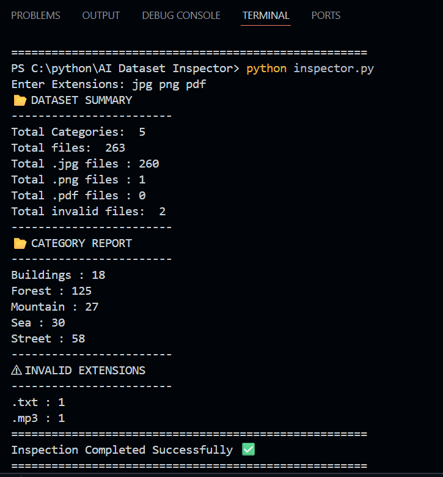

# 📂 AI Dataset Inspector

A command-line Python tool that scans an image dataset, validates user-selected file extensions, and generates category-wise and extension-wise reports.

---
📷 Demo




## 🚀 Features

- Scan datasets organized into category folders.
- Count the total number of categories.
- Count the total number of files.
- Allow users to search for one or multiple file extensions.
- Accept extensions with or without a dot (`jpg` or `.jpg`).
- Accept uppercase, lowercase, or mixed-case extensions (`JPG`, `jpg`, `JpG`).
- Remove duplicate extensions automatically.
- Display the number of matching files for each requested extension.
- Show `0` for requested extensions that are not present in the dataset.
- Count total invalid files.
- Display a summary of invalid file extensions.
- Generate a category-wise report.

---

## 📁 Project Structure

```
AI-Dataset-Inspector/
│
├── dataset/
│   ├── Buildings/
│   ├── Forest/
│   ├── Mountain/
│   ├── Sea/
│   └── Street/
│
├── inspector.py
└── README.md
```

---

## 🛠 Technologies Used

- Python 3
- pathlib (Python Standard Library)
- Lists
- Dictionaries
- Sets
- Loops
- Conditional Statements

---

## ▶️ How to Run

1. Clone this repository.

2. Place your dataset inside the `dataset` folder.

3. Run the program:

```bash
python inspector.py
```

4. Enter one or more file extensions when prompted.

Example:

```
jpg png
```

or

```
.JPG .PNG
```

---

## 📸 Sample Output

```
📂 DATASET SUMMARY

Total Categories: 5
Total Files: 263
Total .jpg files: 260
Total .png files: 1
Total .pdf files: 0
Total Invalid Files: 2

📂 CATEGORY REPORT

Buildings : 16
Forest : 126
Mountain : 28
Sea : 31
Street : 59

⚠ INVALID EXTENSIONS

.txt : 1
.mp3 : 1

Inspection Completed Successfully ✅
```

---

## 🎯 Learning Objectives

This project was built to practice:

- File handling using `pathlib`
- Nested loops
- Lists
- Dictionaries
- Sets
- String manipulation
- User input validation
- Problem solving
- Building a real-world Python project

---

## 🔮 Future Improvements

- Refactor the project using functions.
- Export reports to CSV.
- Add command-line arguments.
- Display file sizes.
- Detect corrupted images.
- Add logging.
- Create a graphical user interface (GUI).

---

## 👨‍💻 Author

**Aanshi Jain**

Building my journey from Python fundamentals to AI Engineering, one project at a time.